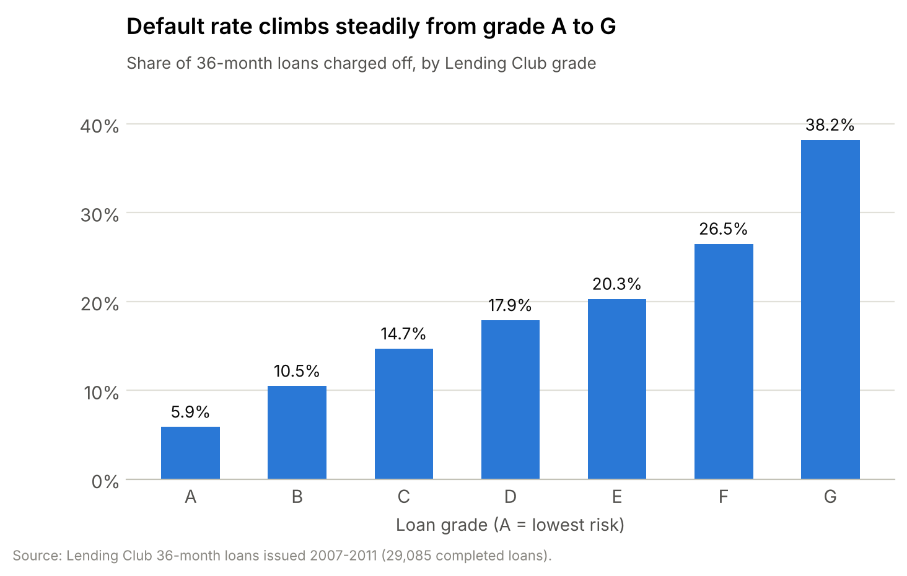
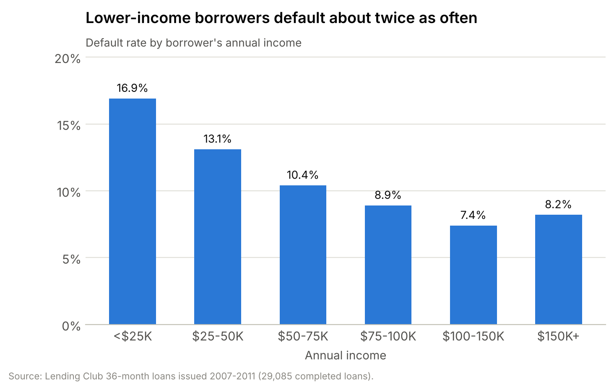
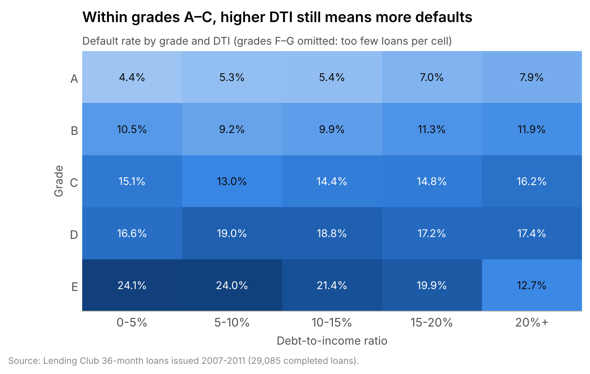
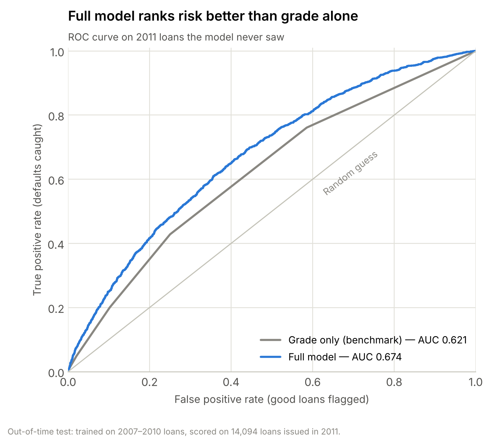
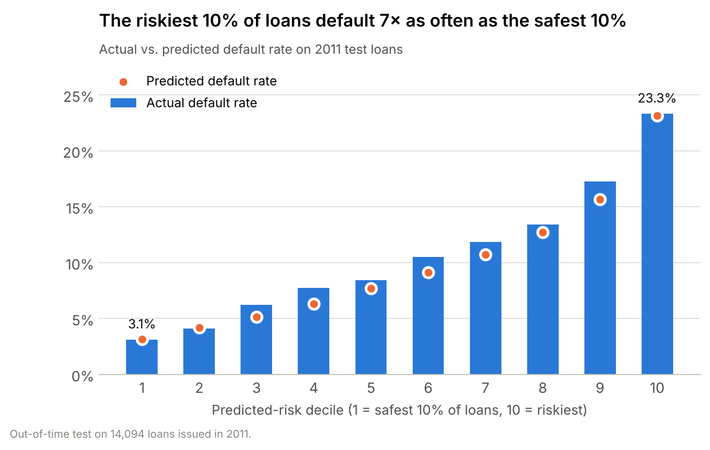
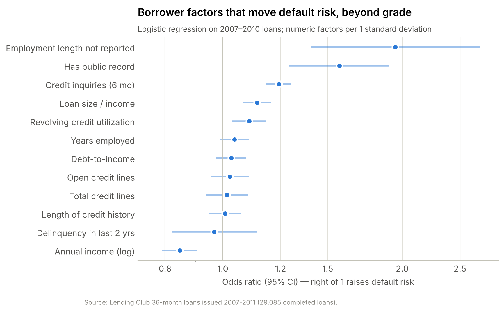
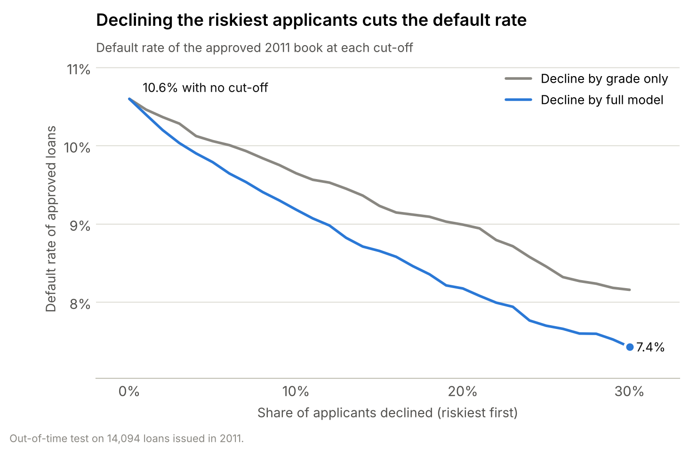

# Consumer Loan Default Analysis — SQL & Python

**Which consumer borrowers default, and can a lender predict it at application?**
An end-to-end credit risk analysis of 29,085 completed Lending Club loans: a SQL pipeline to clean and profile the data, analysis of default drivers, and a logistic regression model validated on a year of loans it never saw.

**Author:** Muhammad Ahsan · [LinkedIn](https://www.linkedin.com/in/ahsan1143) · Level I Candidate in the CFA Program

---

## Key findings

| | |
|---|---|
| **Portfolio** | 11.1% of completed 36-month loans were charged off; a default cost the lender **56% of the principal** on average. |
| **Grade** | Default rate rises from **5.9% (grade A) to 17.9% (D) and 38.2% (G)** — grade is the strongest single driver. |
| **Income** | Borrowers earning under \$25K default at **16.9%**, more than twice the 7.4% rate at \$100–150K. |
| **Debt-to-income** | Default rises from 9.7% (DTI under 5%) to 12.5% (DTI 20%+). Within grade A it nearly doubles, 4.4% → 7.9%. |
| **Purpose** | Small-business loans default at **21.7%**, about twice the book average; credit-card refinancing is the safest at 7.7%. |
| **Model** | Logistic regression scores **AUC 0.674 (Gini 0.35, KS 0.25)** on unseen 2011 loans vs. 0.621 for grade alone. |
| **Decision impact** | Declining the riskiest 10% of 2011 applicants by model score would have avoided **22% of defaults and 26% of principal losses**, cutting the approved default rate from 10.6% to 9.2%. A grade-only cut-off at the same 10% avoids 18% of defaults. |



## Approach

### 1. SQL data pipeline (`sql/`)
- `01_clean_loans.sql` turns the raw file into an analysis table: parses text fields (interest rates, terms, employment length, dates), derives credit-history length and loan-to-income, and bands income and DTI.
- **Population:** 36-month loans that met Lending Club's credit policy and reached a final outcome. Every 36-month loan had matured by the data cut-off (mid-2015). 60-month loans were excluded because about a third were still open, which would overstate their default rate.
- **Leakage control:** only information known at application is used as a predictor. Repayment and recovery fields are kept only to measure losses.
- `02`–`08` are the analysis queries (portfolio overview, grade, income, DTI, grade × DTI matrix, purpose, vintage), using CTEs, conditional aggregation and window functions.

### 2. Drivers of default (`notebooks/loan_default_analysis.ipynb`)

| Income | Debt-to-income within grade |
|---|---|
|  |  |

DTI separates risk inside the prime grades (A–C) but not in D–E, where borrowers were already priced as high-risk.

### 3. Logistic regression
- **Out-of-time validation:** trained on loans issued 2007–2010 (14,991), tested on 2011 (14,094). This mirrors real use: a model built on past loans scoring new applicants.
- **Features:** grade, income (log), DTI, loan-to-income, revolving utilization, recent credit inquiries, public records, delinquencies, credit history length, employment length, home ownership, income verification, loan purpose.
- Interest rate was left out because Lending Club sets it from the grade, so it would double-count the same information.
- Coefficients and confidence intervals from `statsmodels`; prediction pipeline in `scikit-learn`.

| Model (2011 test set) | AUC | Gini | KS | Brier |
|---|---|---|---|---|
| Grade only (benchmark) | 0.621 | 0.243 | 0.178 | 0.093 |
| **Full model** | **0.674** | **0.348** | **0.254** | **0.091** |

Train AUC (0.686) is close to test AUC (0.674), so the model holds up on a new year of loans.

| ROC curve | Predicted vs. actual by risk decile |
|---|---|
|  |  |

**What moves risk beyond grade** (odds ratios, all significant at 5%): each standard-deviation increase in recent credit inquiries raises default odds by 24% and in loan-to-income by 14%; a public record raises them 57%; small-business purpose about doubles them; higher income lowers them (0.85 per SD). Once grade, income and loan size are known, **DTI is no longer statistically significant** — its effect is largely captured by the grade.



### 4. Business application — approval cut-offs

| Riskiest share declined | Approved default rate | Defaults avoided | Principal losses avoided | Good loans declined |
|---|---|---|---|---|
| 0% (baseline) | 10.6% | — | — | — |
| 5% | 9.8% | 12.3% | 14.6% | 521 |
| 10% | 9.2% | 22.0% | 25.5% | 1,080 |
| 15% | 8.7% | 30.6% | 34.3% | 1,657 |
| 20% | 8.2% | 38.3% | 42.6% | 2,246 |



The right cut-off depends on the interest income given up on the good loans declined. Adding that revenue side is the natural next step.

## Limitations
- Loans are from 2007–2011, including the credit crisis; patterns should be re-tested on recent data.
- The data only includes approved applicants, so the model has never seen rejected ones (reject inference).
- Logistic regression was chosen for transparency, which credit models need; tree-based models could raise AUC at the cost of explainability.

## Repository structure
```
consumer-loan-default-analysis/
├── data/
│   ├── processed/loans_clean.csv     # clean analysis table (output of the SQL pipeline)
│   └── raw/                          # raw file goes here (see "How to run")
├── sql/                              # 01 cleaning + 02-08 analysis queries (SQLite)
├── src/
│   ├── download_data.py              # fetches the raw Lending Club file
│   ├── build_database.py             # loads raw data into SQLite and runs 01_clean_loans.sql
│   └── chart_style.py                # shared chart formatting
├── notebooks/loan_default_analysis.ipynb
├── reports/
│   ├── figures/                      # all charts
│   ├── model_performance.csv
│   ├── odds_ratios.csv
│   ├── cutoff_analysis_full_model.csv
│   └── key_findings.txt
└── requirements.txt
```

## How to run
```bash
pip install -r requirements.txt
python src/download_data.py      # ~33 MB raw file
python src/build_database.py     # builds data/lending_club.db
jupyter notebook notebooks/loan_default_analysis.ipynb
```

## Data
Lending Club loan data, loans issued June 2007 – December 2011 (`LoanStats3a.csv`, 42,535 loans), status as of mid-2015. Lending Club no longer hosts its public files; the download script uses a public mirror.
